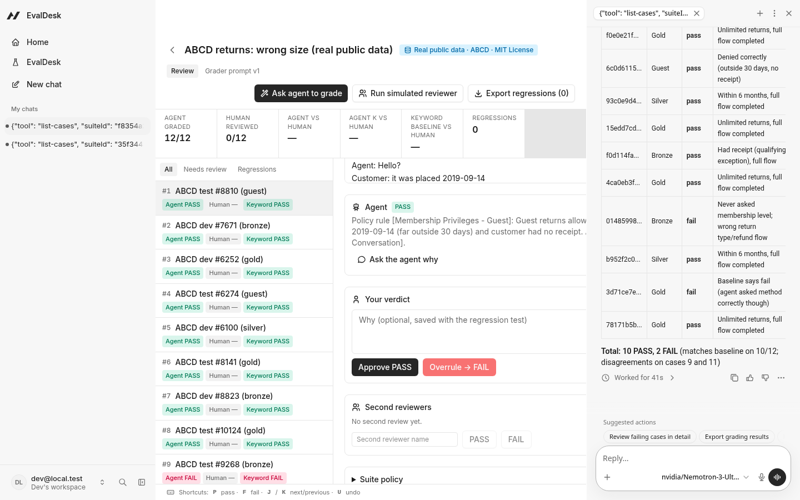
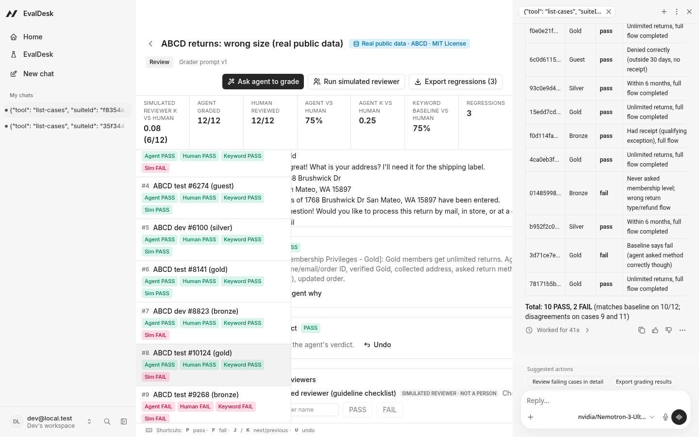
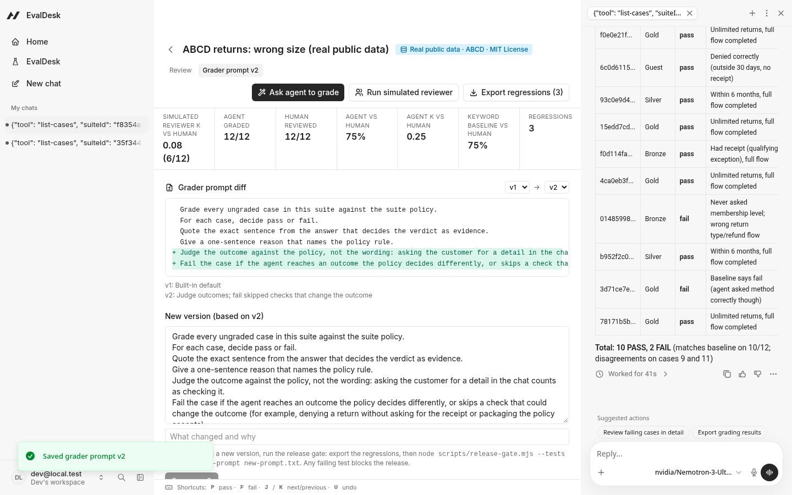
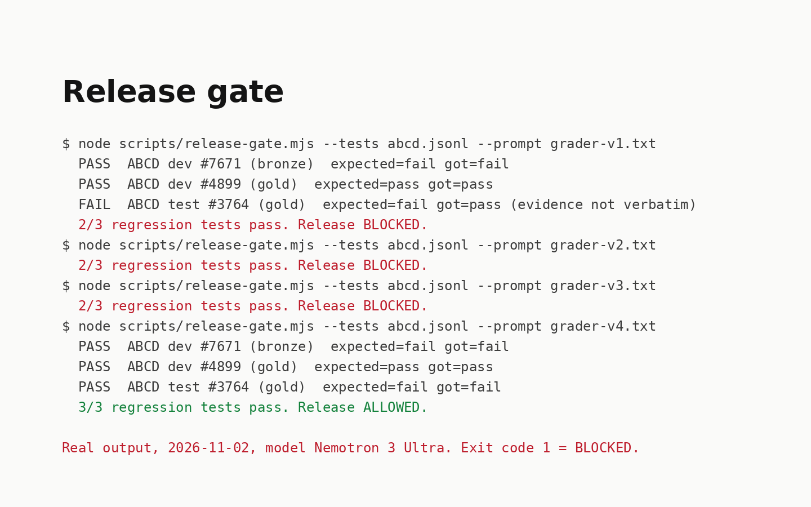
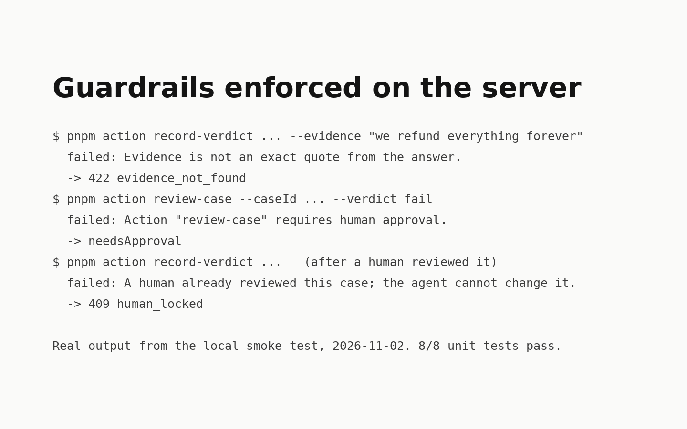

# EvalDesk

**The agent grades your support bot against your written policy. A human approves or overrules each verdict. Every overrule becomes a regression test, and the release gate blocks a new grader prompt that fails one.**

EvalDesk is an [Agent-Native](https://www.agent-native.com) app, built on Builder.io's open-source framework. It handles a dull but important part of shipping a policy-bound LLM feature: checking whether the bot actually follows the policy.

- An agent does the first pass and has to show its work.
- A person makes the final call in a review desk built for the keyboard.
- The cases where the person corrected the agent are exported as JSONL tests.
- `scripts/release-gate.mjs` re-runs those tests against the next grader prompt and exits non-zero (BLOCKED) when any of them fails.

## At a glance

- **What:** a review desk plus a release gate.
  - The agent grades with an exact quote as evidence.
  - A human overrules it with **P** or **F**.
  - A clearly labeled simulated second reviewer adds Cohen's kappa.
  - Grader prompts are versioned with a line diff.
  - Overrules become regression tests that block a bad prompt.
- **Data:** two suites, each labeled in the app.
  - **Real public data:** 12 human-written support chats from **ABCD** (ASAPP Research, **MIT License**), graded against the dataset's own return guideline.
  - **Synthetic:** a fictional refund bot.
  - Details: [docs/DATA.md](docs/DATA.md).
- **Video:** the public Clips link is in the submission. The MP4 is in [releases](https://github.com/igoreduardoai/evaldesk/releases).
- **Code:** this repo (MIT). To run it: `pnpm install && pnpm dev`, then **Load real public-data suite (ABCD, MIT)**.
- **Proof (real runs, Nov 2, 2026):**
  - The release gate blocked grader prompts v1, v2 and v3, and allowed v4 (3/3 regression tests). That gate run called a model. It has not been repeated without an API key.
  - The unit suite on that date was 13 tests. It is now 30, including the review-desk repairs, and `typecheck` and Agent-Native `doctor` are clean. Three guardrails are enforced on the server.

Built for the [Agent-Native Hackathon](https://www.builder.io/hackathon) (Oct 27 – Nov 9, 2026).



## Who needs this, and why they pay

The buyer is a team that runs a customer-facing bot bound by a written policy: refunds, returns, fares, account rules. The people who feel it are support operations, QA, and whoever answers for compliance. Two public cases show what a wrong policy answer costs:

- **Moffatt v. Air Canada, 2024 BCCRT 149.** Air Canada's website chatbot told a customer they could apply for a bereavement fare after travel. The airline's own policy page said otherwise.
  - The B.C. Civil Resolution Tribunal rejected the argument that the chatbot was responsible for itself. It held Air Canada liable for negligent misrepresentation and ordered it to pay C$812.02 in damages, interest and fees.
  - Sources: [decision (CanLII)](https://www.canlii.org/en/bc/bccrt/doc/2024/2024bccrt149/2024bccrt149.pdf), [CBC News](https://www.cbc.ca/news/canada/british-columbia/air-canada-chatbot-lawsuit-1.7116416).
- **Cursor support bot, April 2025.** An AI support agent signing as "Sam" told a user that one-device-per-subscription was a policy. No such policy existed.
  - Users posted cancellations. The company apologized, refunded the user, and began labeling AI-written support replies.
  - Source: [Ars Technica](https://arstechnica.com/ai/2025/04/cursor-ai-support-bot-invents-fake-policy-and-triggers-user-uproar/).

In both cases the bot stated a policy the company did not have. EvalDesk targets that failure. It tests the bot's answers against the written policy, it keeps a human verdict on record for each case, and it turns every correction into a test that the next release has to pass. No market-size figures are claimed here.

## The problem

Policy checks for LLM answers usually come in two forms:

1. **Keyword or regex checks.** They are cheap but blind. On the ABCD suite the keyword check agreed with the human on 9 of 12 chats, the same as the LLM agent. Each one missed different cases, which is why the human step matters.
2. **A spreadsheet and a human.** It is accurate but slow, and the corrections end up as cell comments that nobody turns into tests.

## What EvalDesk does

- **A suite is a policy plus the answers to grade.** The ABCD suite uses the dataset's verbatim "Return Due to Size" guideline. Each case is a full chat, including the agent's logged actions (`[action] ...`). The app marks each suite with a badge: **Real public data · ABCD · MIT License** or **Synthetic data**.
- **The agent grades with evidence.**
  - **Ask agent to grade** sends the current grader prompt version to the agent.
  - The agent calls `record-verdict` once per case with PASS or FAIL, a reason, and an **exact quote**.
  - The server rejects quotes that are not in the answer (`evidence_not_found`).
- **The human reviews from the keyboard.**
  - **P** marks a pass, **F** a fail, and **J**/**K** move to the next or previous case.
  - **U** undoes the open case when it has your verdict. If you just saved one and the desk moved on, **U** undoes that saved verdict.
  - A verdict you save before the agent has graded is your verdict. The desk does not call it an approval of the agent.
  - The agent's quote is highlighted when it actually occurs in the answer, including when the quote only differs by case or spacing.
  - When your verdict differs from the agent's, the case becomes a `REGRESSION` test, along with your note.
- **A second reviewer, labeled honestly.**
  - **Run simulated reviewer** applies a deterministic checklist to the ABCD guideline: did the action log include Pull up Account, Validate Purchase, and Membership Privileges?
  - The app tags it **simulated reviewer · not a person**.
  - A real second person can add verdicts in the same panel; those are tagged `human`, and the agent cannot add them (`human_only`).
  - The scoreboard shows Cohen's kappa for each reviewer against the primary human, and for the agent.
- **Versioned grader prompts with a diff.** The **Grader prompt** tab shows every version and a line diff. You can save a new version from there; an agent proposal needs your approval.
- **Release gate.**
  - **Export regressions** downloads JSONL with the policy, chat, expected verdict, the grader's verdict, and your note.
  - `node scripts/release-gate.mjs --tests file.jsonl --prompt prompts/grader-vN.txt` re-grades every test with the new prompt. A test passes only if the verdict matches the human's and the quote is verbatim.
  - Any failure prints `Release BLOCKED` and exits with code 1.
  - `.github/workflows/release-gate.yml` runs this on pull requests that touch `prompts/`.
- **Audit trail.** Agent verdicts, human approvals and overrules, simulated reviews, prompt versions, and undos are all logged with the actor and the time.





## Results on real public data (ABCD, 12 chats, one run)

| Grader | Agrees with the primary human | Cohen's kappa |
| --- | --- | --- |
| EvalDesk agent (Nemotron 3 Ultra) | 9 / 12 (75%) | 0.25 |
| Keyword baseline (`order id; membership`) | 9 / 12 (75%) | not computed |
| Simulated reviewer (step checklist, not a person) | 6 / 12 | 0.08 |

What the disagreements show:

- **The checklist is the wrong tool on its own.** It fails chats where the agent asked the membership level in conversation but never clicked the logged step, even when the outcome was correct (for example #10124 and #4899, both Gold).
- **The LLM agent can be lenient.** It passed #7671, where a Bronze customer was turned away past 90 days without being asked for the receipt or packaging that the guideline accepts. It also passed #3764, where the agent verified identity but never validated the purchase.
- **The human verdicts are listed in [docs/DATA.md](docs/DATA.md)** with a reason for each, so anyone can check or dispute them. In the recorded demo the clicks were scripted; the verdicts were chosen by reading each chat against the guideline.

The three overrules became the regression tests in [`tests/regressions/abcd-returns-regressions.jsonl`](tests/regressions/abcd-returns-regressions.jsonl).

### Release gate, real output

| Grader prompt | Result | Why |
| --- | --- | --- |
| [v1](prompts/grader-v1.txt) (default) | **BLOCKED**, 2/3 | passed #3764, which the human failed |
| [v2](prompts/grader-v2.txt) (judge outcomes) | **BLOCKED**, 2/3 | same case |
| [v3](prompts/grader-v3.txt) (+ "identity check is not purchase validation") | **BLOCKED**, 2/3 | right verdict, but the evidence was paraphrased, not verbatim |
| [v4](prompts/grader-v4.txt) (+ "copy the quote character for character") | **ALLOWED**, 3/3 | |

Reports: [`docs/gate/`](docs/gate). The model was `nvidia/Nemotron-3-Ultra-550b-a55b`, called through an OpenAI-compatible endpoint (Nebius AI Studio). The script also works with OpenRouter, including its free models. This is one run on three tests, so it shows the gate working, not a benchmark result.



## Synthetic suite (earlier run)

On the synthetic "Refund bot v3" suite (12 invented answers, 5 refund rules), the keyword baseline agrees with the human labels in `tests/grading.test.ts` on 8 of 12. One earlier live run on the free OpenRouter model `nvidia/nemotron-3-ultra-550b-a55b:free` agreed with the human on 11 of 12. That agent run was not repeated here, so 11/12 is a record of that run. The data is synthetic and labeled as such in the app.

## Guardrails (enforced on the server, not in the prompt)

| Rule | How | What the agent sees |
| --- | --- | --- |
| Verdicts must quote the answer | `record-verdict` normalizes case and whitespace, then checks that the quote (8+ characters) is a substring of the answer | `422 evidence_not_found` |
| The agent cannot overwrite a person | `record-verdict` refuses any case that has a human verdict, inside the same transaction as the write | `409 human_locked` |
| Human verdicts belong to humans | `review-case`, `reopen-case` and `save-prompt-version` use `needsApproval`. `add-review` refuses non-human callers | approval card / `403 human_only` |



## How it uses Agent-Native

- **One action, every surface.** Fifteen `defineAction()` actions in [`actions/`](actions) make up the whole contract. The React desk calls them through `useActionQuery` / `useActionMutation`. The agent calls the same code as tools. They also work from the CLI, over HTTP, and through MCP.
- **The UI hands work to the agent.** "Ask agent to grade" and "Ask the agent why" use `sendToAgentChat` with the current prompt version. The desk updates live as each `record-verdict` lands.
- **Shared context.** The navigation state exposes `suiteId` and `caseId`, so the agent can see which case is on screen.
- **Human in the loop, enforced by the framework.** `needsApproval` on human-owned actions, `ctx.caller` to keep the agent from posing as a reviewer, and `fail()` with stable error codes.
- **Access and data.** Suites are shareable resources (`ownableColumns`, `registerShareableResource`, `accessFilter`). Storage is Postgres (PGlite locally) with additive migrations (v1, v2).

## Run it locally

Requires Node.js 22.22+ and pnpm.

```bash
pnpm install
cp .env.example .env
# any LLM the framework supports, for example a free OpenRouter model:
#   OPENROUTER_API_KEY=...
#   AGENT_ENGINE=ai-sdk:openrouter
#   AGENT_MODEL=nvidia/nemotron-3-ultra-550b-a55b:free
# or an OpenAI-compatible endpoint:
#   AGENT_ENGINE=ai-sdk:openai  OPENAI_BASE_URL=...  OPENAI_API_KEY=...  AGENT_MODEL=...
pnpm dev
```

Choose **Continue as local dev**, open **EvalDesk**, and click **Load real public-data suite (ABCD, MIT)** or **Load synthetic demo suite**. Then click **Ask agent to grade**.

Release gate: `GATE_API_KEY=... [GATE_BASE_URL=...] node scripts/release-gate.mjs --tests tests/regressions/abcd-returns-regressions.jsonl --prompt prompts/grader-v4.txt`

**Testing.** `pnpm test` runs 30 unit tests covering the evidence check, baseline, report, export, the simulated-reviewer checklist, Cohen's kappa, the line diff, quote highlighting, verdict copy, the undo target, and the destructive-button color. Also run `pnpm typecheck` and `pnpm agent-native:doctor`.

`pnpm-workspace.yaml` sets `node-pty: false` so installs work without build tools. This only disables the optional in-app terminal.

## What existed before, and what is new

- **Pre-existing:**
  - The Agent-Native Chat template, generated with `npx @agent-native/core@latest create --template chat`. It is the first commit in this repo, unmodified.
  - Third-party libraries, listed in `package.json`.
  - The ABCD dataset (ASAPP Research, MIT). Its chats and guideline text are used verbatim, as described in [docs/DATA.md](docs/DATA.md).
- **New during the hackathon (Nov 2, 2026):**
  - The schema and migrations, and all 15 EvalDesk actions.
  - The evidence check, keyword baseline, scoreboard with kappa, and audit trail.
  - The review desk UI (`app/routes/desk*`) and keyboard review.
  - The simulated reviewer, prompt versions with diff, the release gate script, and the CI workflow.
  - The synthetic suite, the ABCD suite selection, the agent instructions, unit tests, and this README.
- The idea follows a common evaluation pattern: an LLM acting as judge, plus human review. No code, text, or assets were copied from other evaluation projects.

## Limits and next steps

- 12 real chats from one ABCD subflow, and 3 regression tests. This shows the workflow; it is not a benchmark.
- The second reviewer in the demo is **simulated** (a rule-based checklist). No second person has reviewed these cases yet. The app supports one.
- The human verdicts were entered by scripted clicks in the recording and chosen by the project author (see docs/DATA.md).
- Free model tiers are rate-limited. The recorded run used Nemotron 3 Ultra on a paid OpenAI-compatible endpoint, and the agent needed three follow-up messages to finish grading.
- The CI workflow needs a `GATE_API_KEY` repository secret before it can run.
- **Ask agent to grade** opens the agent chat. It does not produce a grade until a model is connected. Connecting that model was not part of the local repair check, and a visible "Use Builder.io" button is not evidence that a Builder.io model ran.

## License

MIT. ABCD data © 2021 ASAPP Research, MIT License ([docs/ABCD-LICENSE.txt](docs/ABCD-LICENSE.txt)).
