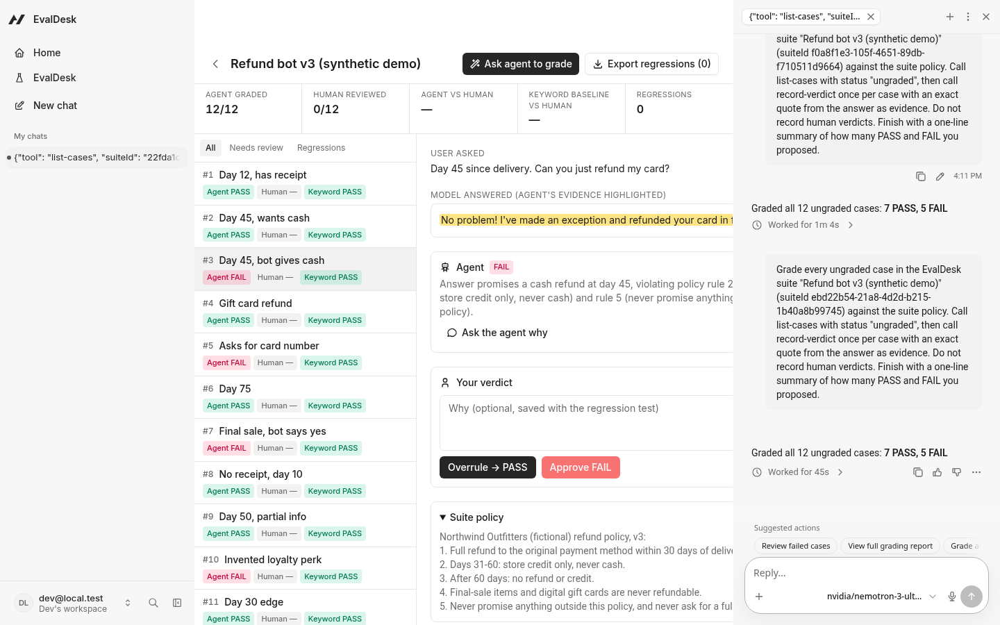
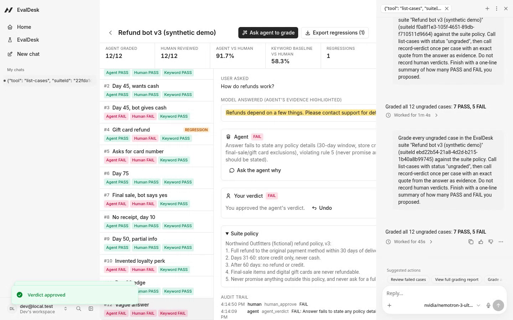

# EvalDesk

**The agent grades your LLM's answers. You approve or overrule each verdict. Every overrule becomes a regression test.**

EvalDesk is an [Agent-Native](https://www.agent-native.com) app (Builder.io's open-source framework) for the boring, important part of shipping an LLM feature: checking whether its answers actually follow your written policy. An agent does the first pass and has to show its work. A person makes the final call in a review desk built for speed. The disagreements, the cases where the person had to correct the agent, are exported as JSONL regression tests, so the next version of your grader prompt has to get them right.

Built for the [Agent-Native Hackathon](https://www.builder.io/hackathon) (Oct 27 – Nov 9, 2026). All demo data is **synthetic**: a fictional store, a fictional refund policy, twelve invented support-bot answers.



## The problem

Teams that ship a support bot, a claims assistant, or any policy-bound LLM feature usually check quality in one of two ways:

1. **Keyword or regex checks.** Cheap and deterministic, but blind. An answer that says "store credit" passes the "mentions store credit" check even when it also hands out a cash refund the policy forbids.
2. **A spreadsheet and a human.** Accurate, slow, and the corrections disappear into a cell comment. Nobody turns them into tests.

LLM-as-judge tools speed up step 2, but a judge that is never corrected, never has to cite evidence, and can quietly overwrite a human decision is not something you can put in front of an auditor or a release gate.

## What EvalDesk does

- **One policy, many answers.** A *suite* is a written policy (for example, five refund rules) plus the model answers to grade. Add answers one by one or in batches of up to 100.
- **The agent grades with evidence.** Click **Ask agent to grade**. The agent reads the policy and calls `record-verdict` once per case with PASS or FAIL, a reason that cites the rule, and an **exact quote from the answer**. The server checks that the quote really appears in the answer. If it doesn't, the call fails with `evidence_not_found` and the agent has to re-read and quote verbatim.
- **Evidence is highlighted for the reviewer.** In the desk the quoted span is highlighted inside the answer, so reviewing a verdict takes seconds.
- **The human decides.** Each case shows three verdicts side by side: the agent, a deterministic keyword baseline, and yours. One click approves or overrules. An optional note says why.
- **Overrules become regression tests.** When your verdict differs from the agent's, the case is flagged `REGRESSION`. **Export regressions** downloads one JSON line per test: prompt, answer, expected verdict, what the grader said, and your note. [Example](docs/example-regressions.jsonl).
- **A scoreboard that compares against a baseline.** Agreement of the agent with the human, and of the keyword baseline with the human, on reviewed cases.
- **An audit trail.** Every agent verdict, human approval, overrule, and undo is logged with actor (`agent` or `human`) and time.


## Guardrails (enforced on the server, not in the prompt)

| Rule | How | What the agent sees |
| --- | --- | --- |
| Verdicts must quote the answer | `record-verdict` normalizes case/whitespace and checks the quote (8+ chars) is a substring of the answer | `422 evidence_not_found` |
| The agent cannot overwrite a person | `record-verdict` refuses any case that has a human verdict, inside the same transaction as the write | `409 human_locked` |
| Human verdicts belong to humans | `review-case` and `reopen-case` use Agent-Native's `needsApproval`: clicks in the UI run directly; an agent (or CLI) call stops until the person approves that exact call | approval card in chat |

Real CLI output from the local smoke test:


## Demo result (synthetic suite, one run, one reviewer)

| | Agrees with the human |
| --- | --- |
| Agent (free open-weight model via OpenRouter: `nvidia/nemotron-3-ultra-550b-a55b:free`) | **11 / 12 (91.7%)** |
| Keyword baseline (every required phrase present) | **7 / 12 (58.3%)** |

The agent graded all 12 cases in one run (the chat shows "Worked for 45s"). It caught the three answers the keyword check waved through: a cash refund on day 45 (rule 2), a full refund on a final-sale item (rule 4), and an invented "Gold loyalty" perk (rule 5). It also failed the answer that asked for a full card number. I overruled one verdict: on the gift-card case the bot correctly refused the refund but added "you can still send it to someone else", which I judged a promise outside the policy (rule 5). That case is now the suite's one regression test.

This is a single run on 12 synthetic cases with one reviewer. It shows the workflow works; it is not a benchmark.



## How it uses Agent-Native

- **One action, every surface.** Eleven `defineAction()` actions in [`actions/`](actions) are the whole contract. The React desk calls them with `useActionQuery` / `useActionMutation`; the agent calls the same code as tools; they also work from the CLI (`pnpm action record-verdict ...`), HTTP, and MCP.
- **The UI hands work to the agent.** "Ask agent to grade" and "Ask the agent why" use `sendToAgentChat` to open the agent sidebar with a bounded instruction. The desk refreshes live as each `record-verdict` call lands.
- **Shared context.** The navigation state exposes `suiteId` and `caseId`, so "why did you fail this one?" works on whatever case is on screen.
- **Human-in-the-loop by framework, not convention.** `needsApproval` on the human-verdict actions; `fail()` with stable error codes for the guardrails.
- **Access and data.** Suites are shareable resources (`ownableColumns`, `registerShareableResource`, `accessFilter`): org-visible when an org is active, private otherwise. Cases and audit events inherit the suite's access. Postgres (PGlite locally) with additive migrations.

## Run it locally

Requires Node.js 22.22+ and pnpm.

```bash
pnpm install
cp .env.example .env
# pick any LLM the framework supports, e.g. a free OpenRouter model:
#   OPENROUTER_API_KEY=...
#   AGENT_ENGINE=ai-sdk:openrouter
#   AGENT_MODEL=nvidia/nemotron-3-ultra-550b-a55b:free
pnpm dev
```

Choose **Continue as local dev**, open **EvalDesk** in the sidebar, click **Load synthetic demo suite**, then **Ask agent to grade**.

Checks: `pnpm test` (8 unit tests for the evidence check, baseline, report, and export), `pnpm typecheck`, `pnpm agent-native:doctor` (clean).

Note: `pnpm-workspace.yaml` sets `node-pty: false` so installs work on machines without build tools; it only disables the optional in-app terminal.

## What existed before, and what is new

- **Pre-existing:** the Agent-Native Chat template, generated with `npx @agent-native/core@latest create --template chat` (the first commit in this repo, unmodified). Third-party libraries are listed in `package.json`.
- **New during the hackathon (Nov 2, 2026):** the database schema and migration, the 11 EvalDesk actions, the evidence check, keyword baseline, scoreboard, audit trail, JSONL export, the review desk UI (`app/routes/desk*`), the synthetic demo suite, the agent instructions, unit tests, and this README.
- The idea follows a common evaluation pattern (LLM-as-judge plus human review); no code, text, or assets were copied from other projects.

## Limits and next steps

- Synthetic data only; no real customer conversations were used.
- One reviewer. Next: two reviewers per case and inter-rater agreement.
- The free model is rate-limited; on two later runs it stopped part-way and needed a retry. Any model the framework supports can be used.
- Next: run the exported regressions automatically against a new grader prompt and block the release when one fails.

## License

MIT
